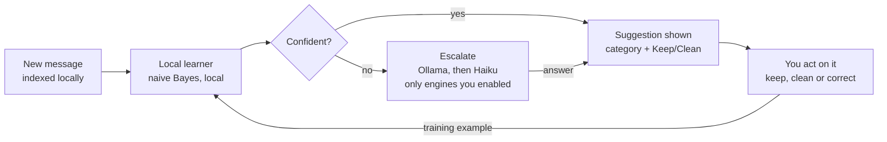

# Inbox Sweeper — Product Design (User-Facing Features)

Oct 10, 2026 · @Teodor

## Overview

Inbox Sweeper is a self-hosted, Mailstrom-style tool that groups a mailbox into bundles and lets one person clean thousands of messages in a few clicks. It works with any IMAP account. It ships as a desktop app; the same codebase can optionally run self-hosted on a server.

Principles the user can feel:

- **Mail stays home.** Messages are indexed and classified locally. Nothing leaves the machine unless the user turns on a cloud engine.
- **Nothing is lost by accident.** Every bulk action shows a preview first and can be undone.
- **The tool learns from you.** A local classifier trains on the user's own actions and corrections. An LLM is optional, never required.
- **Not a mail client.** No reading inbox, composing, replying or sending; it only sorts, cleans and unsubscribes. To read a message properly, the user opens it in their mail client.

Scope: only what the user sees and does. Design system comes next, then tech stack.

## Users and core jobs

The primary user is one technical person with one to several mailboxes, often years of backlog. A household member using the same instance is a secondary case.

| Job | What success looks like |
| --- | --- |
| Shrink a huge backlog | 50,000 messages reduced to a few thousand in one session |
| Keep the inbox clean | A 2-minute daily pass, or rules that do it automatically |
| Stop unwanted mail | Unsubscribe and clean past mail in one step |
| Free storage | See what takes space and remove it by size or attachment |
| Not miss what matters | Personal and important mail is protected and never swept |

## Account connection and onboarding

The user reaches a browsable dashboard in under 5 minutes; the full scan keeps running in the background.

1. **Add account.** Presets for Gmail, Outlook, Fastmail, iCloud and custom IMAP. Sign-in is an **app password** by default (Gmail needs 2-Step Verification for one). Users who can't use app passwords (e.g. work or school Google accounts) can bring their **own OAuth client**: they create it in their own Google Cloud or Azure project and paste its client ID. **Outlook.com accounts always need their own client:** Microsoft no longer accepts app passwords for them. The Outlook preset says so up front and links to setup steps. The app never ships an OAuth client of its own, and never borrows another app's. A connection test lists the folders it found.
2. **Pick folders.** Inbox is selected by default; Archive, All Mail and others are opt-in.
3. **Set protections.** Three checkboxes, pre-ticked: starred/flagged mail, mail from people I've replied to, mail from the last 7 days.
4. **First scan.** A progress bar shows messages indexed and time left. Partial results are usable immediately.
5. **First win.** A card suggests the single biggest cleanup, e.g. "12 senders account for 40% of your inbox".

Several accounts can be added. A switcher shows one account or all of them merged. Each new account gets its own classifier: start fresh or copy one trained on another account.

## Dashboard

The dashboard answers one question: what is the fastest cleanup available right now?

- **Summary tiles:** total messages, unread, storage used, oldest message, cleaned since last visit.
- **Suggestion cards:** ranked by messages removable, each with a one-click action. Examples: "1,240 messages from 8 newsletters you never open", "3.2 GB in attachments older than 2 years".
- **Charts:** top 20 senders by count or size (toggle), mail volume per month, share by category.
- **Progress:** inbox size over time, so the user sees the cleanup working.

Clicking any chart bar or tile opens the matching bundle view, already filtered.

## Bundles

A bundle is a group of messages that share something; it is the unit the user acts on. Bundles are the core screen.

| View | Groups by |
| --- | --- |
| Senders | Exact sender address |
| Domains | Sender domain, with senders nested inside |
| Subjects | Normalized subject (Re:/Fwd:, numbers and dates stripped) |
| Lists | Mailing list ID and List-Unsubscribe presence |
| Categories | Classifier output: Newsletter, Promotion, Notification, Receipt, Social, Personal |
| Size | Size buckets and messages with attachments |
| Age | Month and year received |

**Gmail labels work as folders**, as in Gmail. Nested labels (Work/Clients/Acme) form a folder tree, and any parent can be picked as a whole: selecting Work includes everything beneath it, in filters, bundles, actions and rules. A message with several labels appears in each folder. Delete removes it everywhere; Move and Archive only change the label of the folder being viewed.

Each bundle row shows: name, message count, total size, unread share, **open rate** ("you read 3%"), last received, a 12-month sparkline and a suggestion badge from the classifier.

**Filtering:** a top bar with account, folder, date range, read state, has attachment, size and free-text search. Filters stack across views.

**Drill-down:** opening a bundle shows its messages with a preview pane. The preview is a **short plain-text peek**: headers and the start of the body, converted from HTML to text and shown as text only. Nothing is rendered, no images load, and peeking never marks a message as read. Users can deselect single messages before acting.

**Open the full email.** The app has no HTML reader of its own. **Open in Gmail** opens the message in the user's browser (found by its Message-ID); for other accounts, **Open in mail app** hands the message to the system mail client as an `.eml` file. Opening in Gmail marks the message read, which is fine: a message worth reading is a hint not to bulk-delete its bundle.

**Open attachments.** Attachments are listed with name, type and size. Any one can be downloaded on request and opened in the **system's default app** to see what it is before deciding; the app never displays attachment contents itself. For encrypted files (often PDFs), if the user has pointed the app at a KeePass database (.kdbx), unlocked once per session, and it holds a matching entry, a small note says "A saved password for this file was found in your KeePass database" next to a **Copy password** button. Nothing reaches the clipboard until the user clicks it; the clipboard clears about 30 seconds later. The user pastes the password into the viewer themselves; there is no autofill. An open-first prompt appears whenever a cleanup would remove messages carrying unopened attachments.

**Speed:** multi-select with checkboxes and shift-click; keyboard shortcuts for every action (j/k move, x select, e archive, # delete, u unsubscribe).

## Bulk actions and safety

Every action works on any selection of bundles or messages, and none deletes permanently.

| Action | Result in the mailbox |
| --- | --- |
| Archive | Moved to Archive / removed from Inbox (Gmail: label removed) |
| Delete | Moved to Trash |
| Move | Moved to a chosen folder or label |
| Mark read | Flagged as seen |
| Unsubscribe | See Unsubscribe and block |
| Make a rule | Opens the rule editor pre-filled from the selection |

**Preview before acting.** A confirm sheet shows message count, total size, 5 sample subjects and warnings, e.g. "Includes 3 starred messages" or "Includes mail from someone you replied to". Protected messages are excluded by default; a toggle includes them.

**Deleting without a full backup needs explicit acceptance.** When backup is on and some selected messages aren't fully backed up (over the size limit, or attachments not saved), the sheet says so plainly, e.g. "214 messages will be deleted without a full backup: 12 over the size limit, 190 attachments not saved". The user either accepts it or chooses to fetch the missing content first. This is the decision that counts, because providers empty Trash on their own (Gmail after about 30 days); the same warning appears again at Empty trash.

**Undo.** A toast offers Undo for 10 seconds after any action. Undo also works later from the Activity log, as long as the messages are still recoverable. Under the hood every action records what it needs to reverse it — each message's folder, flags, labels and identity — so putting things back is just replaying that in reverse; the 10-second toast and the later Activity-log undo are the same mechanism, not two.

**Large jobs.** Operations over 500 messages run in a background queue with a progress bar, in chunks (size configurable). The user keeps browsing, and a small action can slip in between chunks of a large one; the affected bundles show a "processing" state.

**Permanent deletion** only happens through an explicit "Empty trash" action that requires typing the message count.

## Smart classification

A local classifier trained by the user is the default; Ollama and Claude Haiku are optional helpers for cases it is unsure about.

| Engine | Runs on | Default | Used for |
| --- | --- | --- | --- |
| Local learner (naive Bayes) | The app itself | On | Categories and Keep/Clean suggestions for every message |
| Local LLM (Ollama or compatible) | User's hardware | Off | Low-confidence messages; one-line bundle summaries |
| Claude Haiku (API key) | Anthropic cloud | Off | Same as local LLM, when no local model is available |

**How it learns.** Every archive, delete, keep or category change is a training example. No separate labelling is needed, but a **Train** screen speeds it up: a card queue of uncertain messages with two big buttons, Keep and Clean, plus a category picker. Twenty cards takes about a minute.

**What the user sees.**

- A category chip and a suggestion badge (Keep / Clean) on each bundle and message.
- A confidence dot: solid for confident, hollow for unsure.
- A "Why?" popover listing the strongest signals, e.g. "has List-Unsubscribe", "domain mailchimp.com", "you deleted 41 of 43 from this sender".
- One click on a wrong chip corrects it and retrains.

**Escalation.** When local confidence is below a threshold the user sets, the message is sent to the next enabled engine. LLM answers also become training examples, so escalations shrink over time.

Every user action feeds the local learner, so it handles more mail on its own over time.

**Cloud guardrails.** Before Haiku is used the first time, the app shows exactly what is sent: sender, subject and the first 500 characters of text. Options: redact email addresses and numbers, a monthly spend cap, and a running cost display.

**Model page.** Training example count, accuracy on the user's last 200 corrections, the most used signals, and a Reset button.

**One model per account.** Each account trains separately, so work and personal mail don't mix. A model copied from another account keeps learning on its own after the copy.

## Rules and recurring cleanup

Rules turn a one-time cleanup into an automatic one.

- **Create from a selection:** "Always archive mail from this sender after 7 days" is two clicks from any bundle.
- **Editor:** conditions (sender, domain, list, subject contains, category, age, size, read state, account) combined with AND/OR, then one action.
- **Dry run:** before saving, the rule shows how many existing messages match, with a sample. The user can also apply it to existing mail once.
- **Schedule:** on new mail, hourly or daily.
- **Rule list:** name, last run, messages affected in the last 30 days, pause toggle.
- **Suggested rules:** after the user does the same thing 3 times to one sender, the app offers a rule.

## Unsubscribe and block

Unsubscribe is one action that also offers to clean past mail and verifies it worked.

1. The user hits Unsubscribe on a bundle.
2. The app picks the best method and shows it: **one-click** (RFC 8058, an HTTPS request; most bulk senders support it), a **web link** opened in the browser, or, for lists that only offer an email address, a pre-filled message handed to the **system mail client** for the user to send. The app itself never sends mail.

   Unsubscribe is offered only when the sender passes **DKIM** for its own domain. For anything else the app suggests **Block** instead: unsubscribing from real spam only confirms the address is live.
3. A checkbox, ticked by default: "Also archive the 214 existing messages".
4. The sender moves to the **Unsubscribe manager**, which tracks status: Requested, Confirmed quiet, or Still sending (with message count since the request).

**Block** is the fallback when unsubscribe fails or isn't offered: it creates a rule that deletes future mail from that sender or domain. Blocks are listed with rules and can be removed.

## Activity log and undo

The activity log is the single place to see and reverse anything the app did, by hand or by rule.

| Column | Example |
| --- | --- |
| Time | Today 09:41 |
| Source | Manual / rule name |
| Action | Archive |
| Scope | 3 bundles: Allegro, Zalando, LinkedIn |
| Messages | 1,812 |
| Status | Done / Running 40% / Failed (with reason) |
| Undo | Available / Expired (messages purged) |

Filters by account, action and source. Totals at the top: messages cleaned and storage freed, this week and all time. Export to CSV.

**How far back undo reaches depends on what is kept.** With just the local activity log on, undo can move a message back for as long as it is still on the server (in Trash or Archive). With a backup destination configured, the app also keeps enough to restore a message even after the provider has purged it. On first run the app asks how long to keep undo history; before it expires for a batch, the app warns and offers a backup.

**Backup before cleanup (optional).** What the app removes can be archived to a local disk, S3, SFTP or WebDAV. Archives are compressed and split into parts, with a separate raw metadata file (headers, original folder, flags, action log entry). The metadata file lets the user find and restore single messages without unpacking every part. Restore starts from the Activity log.

Backup never downloads everything by default; providers cap downloads (Gmail allows about 2,500 MB a day over IMAP).

- **By default:** metadata, plus the message body for messages **under a size limit** the user sets. Attachments are left out and recorded as placeholders (name, type, size), so they can still be fetched while the message exists.
- **Over the limit:** metadata only.
- **On request:** the user can also fetch full contents of large messages and/or attachments, per action or as a setting. The app shows an estimate; big fetches are throttled and may take several days ("backup: day 1 of 3").
- A restored message whose attachments were never saved is marked as such.

## Settings and privacy

- **Accounts:** add, re-authenticate, pause sync, remove. Sign-in by app password, or by the user's own OAuth client ID. If a sign-in stops working (e.g. after a password change), the account shows a clear "Sign in again" prompt. Removing an account deletes its local index and training data.
- **Protections:** starred/flagged, replied-to contacts, recent-days window, a VIP sender list.
- **Classification:** engine on/off, escalation threshold, Ollama URL and model picker (lists installed models), Haiku API key, redaction, monthly spend cap.
- **Sync:** interval, folders per account.
- **Display:** light/dark/system theme, Polish and English UI, density (comfortable/compact), keyboard shortcut reference.
- **Passwords:** optional KeePass (.kdbx) database path and key file for attachment passwords; unlock once per session; never written back; passwords are only copied on the user's click.
- **Access:** in self-hosted mode, a password for the web UI, or "trust reverse proxy auth" for self-hosted setups.
- **Data:** export settings, rules and trained models; wipe all local data; backup destination, schedule and retention; backup size limit and whether to include large messages and attachments; chunk size for large jobs.
- **About:** app version, and a **"What's new"** button that reopens the latest changelog modal any time.

## Screens, scope and open questions

Nine screens cover every feature above; these are the input for the design system.

| Screen | Purpose |
| --- | --- |
| Onboarding | Add account, pick folders, set protections, first scan |
| Dashboard | Summary, suggestion cards, charts |
| Bundles | Grouped views with filters and multi-select |
| Bundle detail | Message list, preview pane, per-message selection |
| Train | Keep/Clean card queue |
| Rules | Rule list and editor with dry run |
| Unsubscribe manager | Status of every unsubscribe and block |
| Activity | Log, totals, undo |
| Settings | Accounts, protections, engines, privacy, display |

**Out of scope:** reading mail in the app (no HTML rendering), replying, composing or sending, shared team inboxes, a native mobile app (the self-hosted web UI should still work on a phone).

**Decisions:**

- **Delivery:** desktop app; optional self-hosted mode from the same codebase.
- **Classifier:** one per account, with the option to copy another account's model.
- **Undo history:** the user chooses retention; optional compressed, partitioned backup to disk, S3, SFTP or WebDAV with a raw metadata file.
- **Gmail labels:** treated as folders, as in Gmail; nested labels form a tree and parent folders can be selected as a whole.

## What's new

When the app opens after an update, a **"What's new" modal** shows what changed since the last version. The user can close it, and reopen it any time from Settings.

- **Written for a tired person.** Every entry is in plain, simple English — short words, short sentences, saying what changed and why it helps. No jargon, no version numbers in the text, nothing the reader has to decode.
- **One small file per entry.** Each changelog entry is its own YAML file, `changelog/<YYYYMMDDTHHMMSS>-<slug>.yml`, holding one flat line: date, description and commit hash. A build step gathers and sorts them for the modal. One file per entry means two people (or two sessions) never edit the same file, so the changelog can't cause merge conflicts; a single shared file would, since every entry is added at the same spot. Timestamps in the names follow the same rule as migration names.
- **The LLM writes its own entry.** Whoever makes a code change writes the matching changelog line as part of that same change — in the plain English above — so the changelog is never a separate afterthought and never drifts from what actually shipped.

**Next:** design system (tokens, components, the nine screens), then tech stack.
